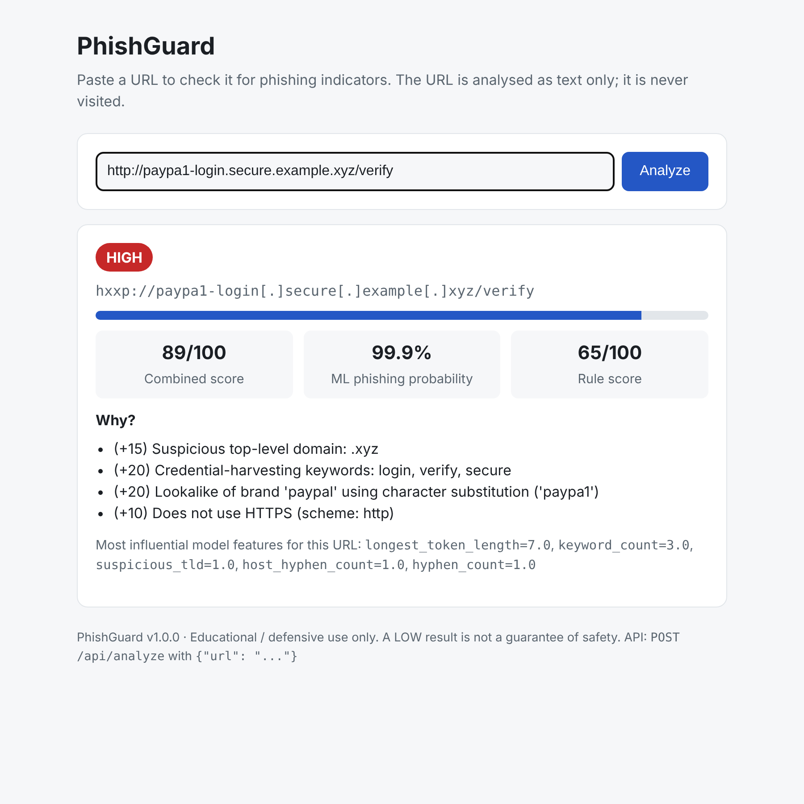
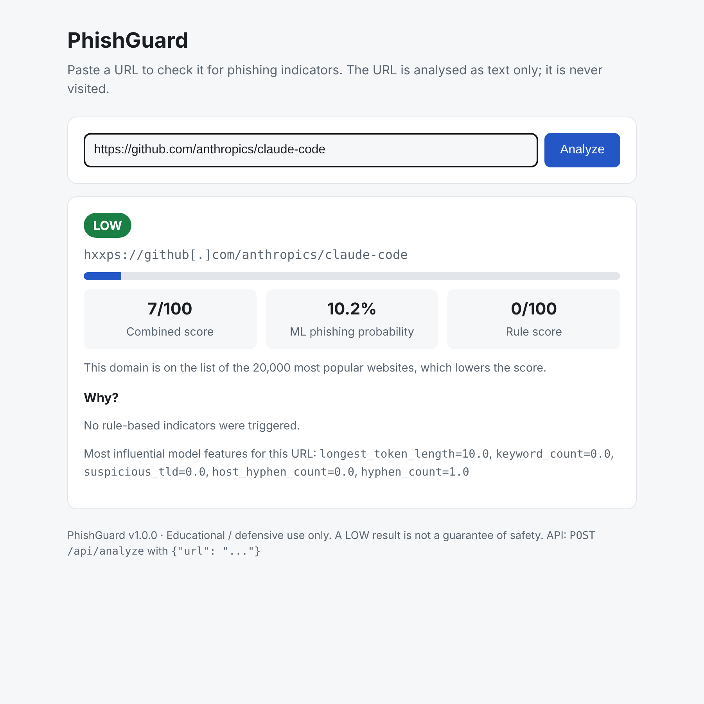

# PhishGuard: Hybrid Phishing URL Detector


PhishGuard classifies a URL as **LOW / MEDIUM / HIGH** phishing risk by combining

1. an **explainable rule engine** (12 weighted heuristics, each with a plain-English reason), and
2. a **machine-learning model** (Gradient Boosting on 37 lexical URL features) trained on ~40,000 real URLs,

plus a **popularity allowlist** to avoid flagging well-known sites. It ships as a command-line tool, a web app, and a JSON API. URLs are analysed **as text only: PhishGuard never visits them.**

| Phishing URL | Legitimate URL |
|---|---|
|  |  |

> This project extends an earlier single-file, rule-based detector. The original 12 rules are kept (`phishguard/rules.py`) and are now one component of a larger system.

## Features
- Hybrid scoring: `0.7 × ML probability + 0.3 × rule score` (falls back to rules-only if no model is present)
- Explains every verdict: which rules fired and which model features mattered
- Defanged output (`hxxp://example[.]com`) so results are safe to paste into tickets
- CLI (single URL, many URLs, bulk file, CSV export), Flask web UI, and REST API
- Reproducible pipeline: dataset builder → feature extraction → training → evaluation plots
- 53 automated tests and GitHub Actions CI

## Quick start
```bash
git clone https://github.com/Kanhaiyathakur001/PhishGuard.git
cd PhishGuard
python -m venv .venv && source .venv/bin/activate     # Windows: .venv\Scripts\activate
pip install -r requirements.txt
```

**Command line**
```bash
python -m phishguard "http://paypa1-login.secure.example.xyz/verify"
python -m phishguard -f sample_urls.txt -o results.csv
```

**Web app**
```bash
python app/app.py          # open http://127.0.0.1:5000
```

**API**
```bash
curl -X POST http://127.0.0.1:5000/api/analyze \
     -H "Content-Type: application/json" \
     -d '{"url": "http://paypa1-login.secure.example.xyz/verify"}'
# batch (max 100):  {"urls": ["...", "..."]}
```

**Example output**
```
URL   : hxxp://paypa1-login[.]secure[.]example[.]xyz/verify
RISK  : HIGH  (score 90/100)
MODE  : hybrid | ML phishing probability: 100.0% | rule score: 65
WHY   :
   - (+15) Suspicious top-level domain: .xyz
   - (+20) Credential-harvesting keywords: login, verify, secure
   - (+20) Lookalike of brand 'paypal' using character substitution ('paypa1')
   - (+10) Does not use HTTPS (scheme: http)
```

## How it works
```
 URL ──► parse ──┬─► rule engine (12 rules) ───────────────┐
                 ├─► 37 lexical features ─► Gradient Boosting ─┼─► 0.7·ML + 0.3·rules ─► allowlist check ─► LOW / MEDIUM / HIGH
                 └─► registered domain ─► top-20k allowlist ┘
```
Risk bands: **0–24 LOW, 25–49 MEDIUM, 50+ HIGH.**

### The 12 rules
| # | Rule | Points |
|---|------|--------|
| 1 | Raw IP address as host | 30 |
| 2 | More than 3 subdomains | 15 |
| 3 | Suspicious TLD (.xyz, .top, .tk, …) | 15 |
| 4 | `@` in the URL authority | 25 |
| 5 | URL shortener (bit.ly, tinyurl, …) | 15 |
| 6 | Phishing keywords (login, verify, …) | 10 each, max 20 |
| 7 | URL > 75 characters / 3+ hyphens in host | 10 each |
| 8 | Punycode / digit-substitution lookalike (`paypa1`) | 20 each |
| 9 | No HTTPS | 10 |
| 10 | Brand name present but not the real domain | 25 |
| 11 | Double slash in path | 10 |
| 12 | Non-standard port | 10 |

Weights reflect how specific each signal is: structural tricks that almost never appear on honest sites (`@` in authority, raw IP host, brand on the wrong domain) score highest; signals that also occur on legitimate sites (no HTTPS, long URL) score lowest. The weights are expert-chosen heuristics, not fitted values, which is why an ML model sits alongside them.

### The ML model
37 features computed from the URL string only (length, character counts and ratios, entropy of host/path, subdomain count, TLD, keyword and brand signals, longest token, hex-token presence, …); see `phishguard/features.py`. Four classifiers were compared and the best by ROC-AUC was kept (Gradient Boosting; it also gave the smallest model file, ~200 KB).

## Results
Dataset: **40,000 URLs** (20,000 phishing, 20,000 legitimate). Evaluation uses an 80/20 split **grouped by registered domain**: no domain appears in both training and test sets, so the scores measure generalisation to unseen sites rather than memorisation.

| Model | Accuracy | Precision | Recall | F1 | ROC-AUC |
|---|---|---|---|---|---|
| Logistic Regression | 0.826 | 0.889 | 0.749 | 0.813 | 0.907 |
| Decision Tree | 0.830 | 0.897 | 0.750 | 0.817 | 0.899 |
| Random Forest | 0.884 | 0.900 | 0.867 | 0.883 | 0.952 |
| **Gradient Boosting (selected)** | **0.885** | 0.911 | 0.854 | 0.882 | **0.957** |
| Rules only (original project) | 0.591 | 0.994 | 0.190 | 0.319 | 0.678 |
| Hybrid, MEDIUM+ counts as phishing | 0.874 | 0.845 | 0.918 | 0.880 | 0.956 |
| Hybrid, only HIGH counts | 0.863 | 0.957 | 0.761 | 0.848 | 0.956 |

Reading the table honestly:
- The **rules alone are extremely precise (99%) but miss ~81% of phishing** since most real phishing URLs don't trip any of the 12 rules. ML raises recall from 19% to ~85%.
- The hybrid's value is **explainability and a safe fallback**, plus a tunable trade-off (MEDIUM+ favours recall at 92%, HIGH-only favours precision at 96% with a 3.4% false-positive rate, both measured before the allowlist). Pure ML is slightly more accurate on this benchmark.
- Reports and plots: [`reports/metrics.json`](reports/metrics.json), [`confusion_matrix.png`](reports/confusion_matrix.png), [`roc_curve.png`](reports/roc_curve.png), [`feature_importance.png`](reports/feature_importance.png).

**Real-world spot check.** On a small hand-picked set of 20 well-known legitimate URLs (GitHub, PayPal, Google sign-in, Wikipedia, Amazon, SBI, …) and 8 phishing-style URLs, the full system labels 19/20 legitimate URLs LOW and all 8 phishing URLs HIGH. The one miss is a Google Drive share link, which is deliberately *not* allowlisted because Drive is widely abused. This set is tiny and written by the authors, so treat it as a sanity check, not a benchmark. Run it with `python scripts/real_world_check.py` (a subset is also asserted in `tests/test_detector.py`).

## Dataset
| Class | Source |
|---|---|
| Phishing | [Phishing.Database](https://github.com/mitchellkrogza/Phishing.Database) "ACTIVE" feed |
| Legitimate (75%) | "good" URLs from [faizann24/Using-machine-learning-to-detect-malicious-URLs](https://github.com/faizann24/Using-machine-learning-to-detect-malicious-URLs) |
| Legitimate (25%) | Homepages of top-ranked domains, [zer0h/top-1000000-domains](https://github.com/zer0h/top-1000000-domains) |

Stored defanged in `data/dataset.csv`. Details and caveats: [`data/README.md`](data/README.md). Rebuild with `python scripts/build_dataset.py --help`.

## Re-training
```bash
python scripts/train.py        # ~1 min; rewrites models/model.joblib and reports/*
pytest -q
```

## Project structure
```
phishguard/        rules.py  features.py  model.py  trust.py  detector.py  cli.py
app/               Flask app + HTML template
scripts/           build_dataset.py  train.py
data/              dataset.csv  top_domains.txt  README.md
models/            model.joblib
reports/           metrics.json + plots
tests/             53 pytest tests
docs/              PROJECT_REPORT.md  screenshots
.github/workflows/ ci.yml
```

## Limitations
- **Lexical only.** It never fetches the page, checks WHOIS/domain age, TLS certificates, or live blocklists, so a phishing page on a clean-looking domain can score LOW.
- **Dataset bias.** Legitimate URLs come from an older crawl (DMOZ era) and a domain ranking, while phishing URLs are recent. The model may partly learn "old-style URL vs modern URL". The ~88% figure should not be expected to hold on arbitrary real traffic. Modern legitimate URLs (long tracking query strings, app-style paths) are under-represented.
- **Allowlist trade-off.** Popular domains are capped at LOW, so a compromised popular site or an open redirect on one would be under-reported. The allowlist cannot be fairly scored on this dataset because the legitimate homepages were drawn from the same ranking.
- **Static feed.** Phishing tactics change; the model needs periodic re-training on fresh data.
- A LOW result is **not** a guarantee of safety.

## Future work
- Page-content and visual-similarity features; WHOIS/domain age; certificate features
- VirusTotal / URLScan.io lookups for MEDIUM+ results
- Fresher and larger benign data (e.g. Tranco list + crawled URLs) and a time-based split
- Browser extension front-end

## Author
Add your name, roll number, course and guide here.

## Disclaimer
For educational and defensive use only. Do not use it as the sole basis for security decisions.

## License
MIT. See [LICENSE](LICENSE).
